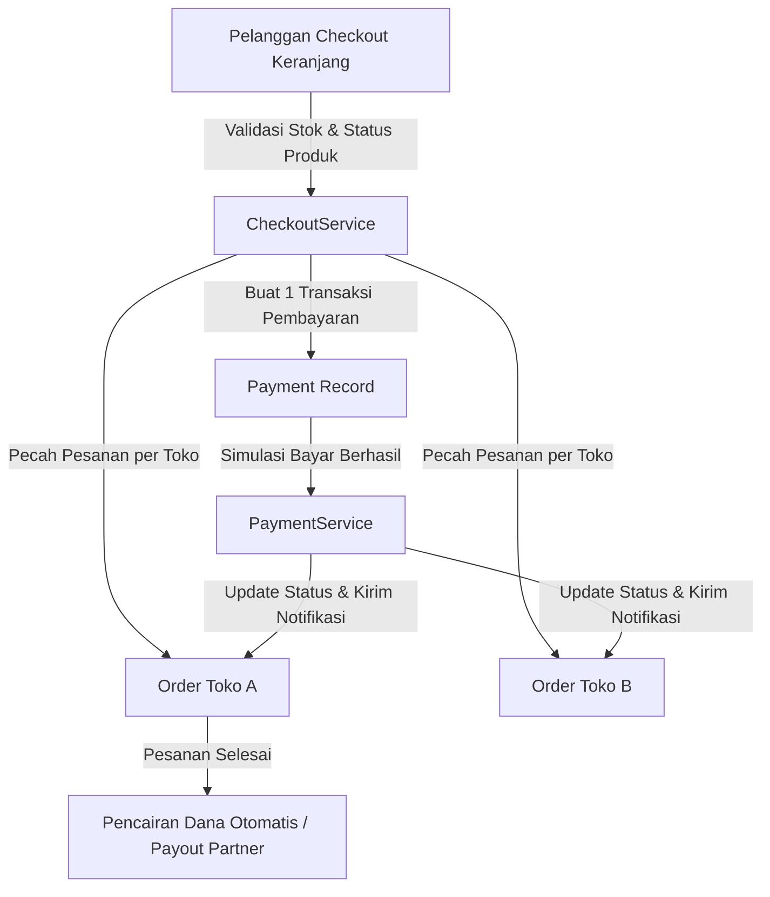

<div align="center">

# 📷 LensMart
### *Multi-Vendor Photography Marketplace Platform*

[](https://laravel.com)
[](https://php.net)
[](https://tailwindcss.com)
[](https://alpinejs.dev)
[-success?style=for-the-badge&logo=checkmarx&logoColor=white)](#-pengujian--kualitas-kode)
[](#)

<p align="center">
  <b>Marketplace fotografi multi-vendor yang menghubungkan fotografer dengan partner toko terverifikasi.</b><br>
  Dilengkapi arsitektur checkout multi-toko (split-order), simulasi payment gateway terpadu, sistem komisi otomatis, portal partner, serta dashboard moderasi admin.
</p>

[Fitur Utama](#-fitur-utama) •
[Arsitektur Sistem](#-arsitektur--logika-bisnis) •
[Akun Demo](#-akun-demo) •
[Instalasi](#-instalasi--quick-start) •
[Pengujian](#-pengujian--kualitas-kode)

</div>

---

## 🌟 Sorotan Proyek (*Project Highlights*)

- 🛒 **Multi-Vendor Split-Order Checkout:** Pelanggan dapat checkout barang dari berbagai toko sekaligus; sistem otomatis memecah pesanan per vendor dengan 1 pembayaran tunggal yang aman.
- 💳 **Unified Payment Gateway Simulation:** Mendukung simulasi instan untuk Transfer Bank, E-Wallet, QRIS, dan COD dengan audit riwayat status transaksi.
- 🏪 **Partner Merchant Portal:** Manajemen katalog produk terverifikasi, spesifikasi teknis dinamis, pemrosesan pesanan bertahap, serta riwayat pencairan dana (*payout*).
- 🛡️ **Enterprise Security & Reliability:** Dilengkapi *race-condition prevention* (DB locking untuk stok produk), transaksi atomik database (`DB::transaction`), otorisasi *Policy* ketat per resource, serta sanitasi file upload.
- 🧪 **100% Automated Test Suite:** Didukung 47 automated feature & unit tests dengan 224 assertions untuk menjaga stabilitas alur bisnis kritis.

---

## 🚀 Fitur Utama

### 🌐 Publik & Pembeli
- **Katalog & Filter Presisi:** Pencarian instan berdasarkan kategori, merek, kondisi produk (baru/bekas), rentang harga, dan rating.
- **Detail Produk Komprehensif:** Galeri foto multi-angle, spesifikasi teknis terstruktur, tabel kompatibilitas perangkat, dan ulasan pelanggan.
- **Komparasi Produk:** Fitur perbandingan hingga 3 kamera/lensa secara berdampingan.
- **Keranjang Cerdas & Wishlist:** Seleksi produk per checkbox sebelum checkout, deteksi otomatis ketersediaan stok, dan indikator status toko.

### 👤 Pelanggan (Customer)
- **Multi-Address Management:** Manajemen alamat pengiriman lengkap dengan pilihan kurir per toko.
- **Order Tracking & Timeline:** Pelacakan pesanan real-time dari konfirmasi, pengemasan, pengiriman nomor resi, hingga penerimaan.
- **Ulasan Terverifikasi:** Pelanggan hanya dapat memberi rating dan ulasan pada barang yang statusnya telah diterima (`completed`).

### 🏬 Mitra Penjual (Partner)
- **Analytics Dashboard:** Statistik omzet, pesanan baru masuk, peringatan stok menipis, dan grafik performa 6 bulan.
- **Manajemen Produk & Verifikasi:** CRUD produk lengkap dengan spesifikasi teknis, kompatibilitas gear, dan alur kurasi admin.
- **Fulfillment Pesanan:** Pemrosesan status pesanan bertahap (*Confirmed → Processing → Shipped → Delivered*).
- **Keuangan & Payout:** Perhitungan otomatis komisi platform serta pengajuan pencairan dana hasil penjualan.

### 🛡️ Moderasi & Platform (Admin)
- **Verifikasi Partner & Produk:** Sistem verifikasi bertingkat untuk menjaga kualitas dan kredibilitas ekosistem.
- **Manajemen Master Data:** Konfigurasi kategori, merek kamera/lensa, dan atribut spesifikasi kustom.
- **Laporan Keuangan & Ekspor:** Laporan komisi dan omzet platform yang dapat diekspor ke **PDF** (DomPDF) dan **Excel** (Laravel Excel).
- **Moderasi Konten & Dispute:** Penanganan ulasan bermasalah dan persetujuan pencairan dana partner.

---

## 🏗️ Arsitektur & Logika Bisnis



### Aturan Bisnis Inti:
1. **Atomic Transaction:** Pembuatan pembayaran, pesanan multi-toko, pengurangan stok, dan pembersihan keranjang dibungkus dalam `DB::transaction`. Jika salah satu gagal, seluruh transaksi di-*rollback*.
2. **Pencegahan Race Condition:** Menggunakan *Pessimistic Locking* (`lockForUpdate()`) saat validasi checkout dan simulasi pembayaran untuk mencegah *double-spending* atau *overselling*.
3. **Komisi Platform Dinamis:** Dihitung otomatis per pesanan toko (default 5%) dan dikonfigurasi melalui [`config/lensmart.php`](config/lensmart.php).
4. **State Machine Pesanan:** Pesanan diproteksi agar hanya dapat berpindah satu tingkat maju secara berurutan dan status final tidak dapat dimanipulasi secara ilegal.

---

## 💻 Teknologi yang Digunakan

| Kategori | Teknologi |
|---|---|
| **Backend Framework** | Laravel 12 (PHP 8.2+) |
| **Frontend UI** | Blade Templating, Tailwind CSS 3, Alpine.js 3 |
| **Asset Bundler** | Vite 6 |
| **Database** | SQLite (Default Dev/Test) / MySQL Compatible |
| **Autentikasi** | Laravel Breeze (Session-based Multi-Role Guard) |
| **Laporan & Ekspor** | DomPDF (PDF Reporting) & Maatwebsite Laravel Excel (XLSX) |
| **Testing Engine** | PHPUnit / Pest Test Runner (SQLite In-Memory) |

---

## 🔑 Akun Demo

Seluruh akun demo siap pakai telah disediakan via database seeder.  
Default password untuk semua akun: `password`

| Peran | Nama Akun | Email | Akses Utama |
|---|---|---|---|
| 👑 **Admin** | Administrator Utama | `admin@lensmart.test` | Verifikasi Toko/Produk, Laporan, Payout |
| 🏬 **Partner 1** | Kamera Nusantara | `partner1@lensmart.test` | Toko Kamera DSLR/Mirrorless |
| 🏬 **Partner 2** | Lensa Pro Studio | `partner2@lensmart.test` | Toko Lensa Prime & Zoom |
| 🏬 **Partner 3** | GearUp Fotografi | `partner3@lensmart.test` | Toko Aksesori & Lighting |
| 🛍️ **Pelanggan** | Customer Demo | `customer@lensmart.test` | Checkout, Order Tracking, Ulasan |

---

## ⚡ Instalasi & Quick Start

Pastikan komputer Anda telah terinstal **PHP 8.2+**, **Composer**, dan **Node.js (v18+)**.

### 1. Clone & Pasang Dependensi
```bash
git clone https://github.com/Rikiyp/LensMart.git
cd LensMart

composer install
npm install
```

### 2. Konfigurasi Environment
```bash
# Salin file konfigurasi environment
cp .env.example .env

# Generate APP_KEY
php artisan key:generate
```

### 3. Setup Database (SQLite)
```bash
# Buat file database lokal jika belum ada (Windows PowerShell)
type nul > database/database.sqlite

# Atau jika di Bash / macOS / Linux:
# touch database/database.sqlite
```

### 4. Migrasi & Seed Data Lengkap
```bash
php artisan migrate:fresh --seed
php artisan storage:link
npm run build
```

### 5. Jalankan Server Lokal
```bash
php artisan serve
```
Aplikasi dapat diakses melalui peramban di: **`http://127.0.0.1:8000`**

Untuk mode development dengan Vite live reload:
```bash
npm run dev
```

---

## 🧪 Pengujian & Kualitas Kode

LensMart dilengkapi dengan pengujian otomatis (*automated testing*) menyeluruh untuk memastikan seluruh logika bisnis, otorisasi, dan transaksi berjalan aman tanpa regresi.

```bash
php artisan test
```

```text
  PASS  Tests\Unit\...
  PASS  Tests\Feature\Auth\...
  PASS  Tests\Feature\CheckoutTest
  PASS  Tests\Feature\OrderLifecycleTest
  PASS  Tests\Feature\PaymentSimulationTest
  PASS  Tests\Feature\ReviewTest
  PASS  Tests\Feature\RoleAccessTest

  Tests:    47 passed (224 assertions)
  Duration: ~5.8s
```

Pengujian dijalankan di memori (`:memory:` SQLite) sehingga aman dijalankan kapan pun tanpa mengubah data database demo lokal Anda.

---

## 📁 Struktur Direktori Penting

```text
LensMart/
├── app/
│   ├── Enums/            # State machine status order, payment, & produk
│   ├── Http/Controllers/ # Controller publik, pelanggan, partner, admin
│   ├── Http/Middleware/  # Proteksi role pengguna & status verifikasi toko
│   ├── Http/Requests/    # Validasi request form yang ketat & bersih
│   ├── Models/           # Model Eloquent & relasi database
│   ├── Observers/        # Observer siklus hidup produk & pesanan
│   ├── Policies/         # Otorisasi akses data berbasis user ownership
│   └── Services/         # Layer logika bisnis (Checkout, Payment, OrderStatus)
├── config/               # Pengaturan komisi, kurir, dan metode pembayaran
├── database/             # Migrasi skema & database seeder demo
├── resources/views/      # Tampilan antarmuka Blade dengan Tailwind CSS
├── routes/               # Rute web terpisah berdasarkan role pengguna
└── tests/                # Automated feature & unit test suite
```

---

## 📄 Lisensi & Atribusi Aset

- Proyek ini dirilis di bawah lisensi [MIT License](LICENSE).
- Foto demo produk menggunakan aset berlisensi bebas dari Wikimedia Commons dan sampel galeri publik. Dokumentasi atribusi lengkap tersedia di [`docs/IMAGE-CREDITS.md`](docs/IMAGE-CREDITS.md).

---

<div align="center">
  <sub>Dikembangkan dengan ❤️ sebagai proyek portofolio Full-Stack Web Development.</sub>
</div>
